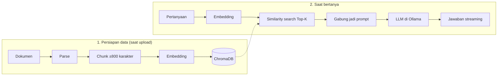

<div align="center">


# Contekan

**Chat dengan dokumenmu sendiri. AI "buka contekan" dulu sebelum menjawab, semuanya jalan lokal.**

[](https://nuxt.com)
[](https://fastapi.tiangolo.com)
[](https://python.org)
[](https://www.trychroma.com)
[](https://ollama.com)

[Fitur](#fitur) • [Cara kerja](#cara-kerja) • [Mulai cepat](#mulai-cepat) • [Konfigurasi](#konfigurasi) • [Alur demo](#alur-demo) • [Troubleshooting](#troubleshooting)

</div>

Contekan adalah aplikasi web chat bergaya ChatGPT/Claude/Gemini yang menjawab pertanyaan berdasarkan dokumen yang kamu upload (PDF, Word, Excel, dan lainnya), bukan cuma dari hafalan model. Tanpa cloud dan tanpa API key: Nuxt, FastAPI, SQLite, ChromaDB, dan model di Ollama semuanya jalan di komputermu.

Proyek ini dibuat sebagai demo **masterclass RAG (Retrieval-Augmented Generation)**. Teori singkatnya ada di [MAIN.md](./MAIN.md).

> [!NOTE]
> Belum ada screenshot di repo ini. Kalau mau menambahkan, taruh gambarnya di `docs/` lalu tautkan di sini.

## Fitur

**Chat**
- Jawaban mengalir lewat streaming (SSE), bisa dihentikan, dibuat ulang, disalin, dan dirender sebagai Markdown.
- Riwayat chat tersimpan, bisa diganti nama dan dihapus. Pesan terakhir ikut jadi konteks untuk pertanyaan lanjutan.
- Model chat bisa diganti langsung dari kotak prompt, dan file bisa dilampirkan seperti di Gemini.

**Memory dokumen**
- Dokumen tersimpan permanen dan dipakai di semua chat. Tiap dokumen bisa dinonaktifkan sementara tanpa dihapus.
- Format: `.txt`, `.md`, `.pdf`, `.docx`, `.xlsx`, `.csv` (maks 10 MB, bisa diubah), atau tempel teks langsung.
- Upload diproses di background dengan status *Memproses → Siap/Gagal*. Isi dokumen bisa dibuka di panel samping.

**Transparan untuk demo**
- Tiap jawaban punya panel **Lihat proses RAG**: Retrieval (potongan + skor kemiripan), Augmentation (prompt yang dikirim), Generation (model yang menjawab).
- Sumber jawaban bisa diklik untuk melihat potongan yang dipakai di dokumen aslinya.
- Jawaban yang tidak bersumber dari dokumen diberi label "Dari pengetahuan model, bukan dari dokumen".

**Lainnya**: halaman Pengaturan (Top-K, ambang kemiripan, batas ukuran file, model, system prompt), responsif sampai layar HP, dan optimistic UI supaya chat, upload, dan toggle terasa instan.

## Cara kerja



1. **Persiapan data**: dokumen dipecah per paragraf lalu kalimat (rekursif, overlap 100 karakter). Tabel `.csv`/`.xlsx`/`.docx` dipecah dengan menjaga nama kolom dan judulnya. Tiap potongan diubah jadi vektor oleh `nomic-embed-text` dan disimpan di ChromaDB, sedangkan file asli dan metadatanya ada di folder `data/` dan SQLite.
2. **Retrieval**: pertanyaan di-embedding dengan model yang sama, lalu dicari potongan paling mirip (cosine). Diambil Top-K (default 3), dan yang skornya di bawah ambang dibuang.
3. **Augmentation**: potongan yang lolos digabung dengan pertanyaan dan beberapa pesan terakhir menjadi prompt.
4. **Generation**: LLM menyusun jawaban dari konteks itu dan mengirimnya lewat SSE. Semua pesan beserta sumbernya disimpan di SQLite.

## Mulai cepat

### Prasyarat

- [Ollama](https://ollama.com) yang sedang berjalan
- [uv](https://docs.astral.sh/uv/) dan Python 3.12+
- Node.js 20+ dan npm

```bash
ollama pull gemma3:1b
ollama pull nomic-embed-text:latest
```

> [!TIP]
> `gemma3:1b` cepat tapi sering salah menghitung dan kadang mengarang. Untuk hasil lebih rapi, tarik juga `qwen2.5:3b` (±1,9 GB, muat penuh di GPU 4 GB) lalu pilih lewat kotak prompt atau halaman Pengaturan.

### Menjalankan

Buka dua terminal.

**Backend** (port 8000):

```bash
cd masterclass-rag-backend
uv sync
uv run fastapi dev
```

**Frontend** (port 3000):

```bash
cd masterclass-rag-frontend
npm install
npm run dev
```

Buka <http://localhost:3000>. Request ke `/api/*` diteruskan otomatis oleh Nuxt ke FastAPI, jadi tidak ada urusan CORS. Dokumentasi API interaktif ada di <http://localhost:8000/docs>.

> [!WARNING]
> Kalau jawaban muncul sekaligus di akhir (tidak mengalir), proxy Nuxt kemungkinan mem-buffer SSE. Jalankan frontend dengan `NUXT_PUBLIC_API_BASE=http://localhost:8000 npm run dev` supaya browser langsung ke backend.

## Konfigurasi

Yang sering diubah ada di halaman **Pengaturan**. Sisanya lewat environment variable atau file `.env` di folder backend (contoh: [.env.example](./masterclass-rag-backend/.env.example)):

| Variabel | Default | Fungsi |
|---|---|---|
| `OLLAMA_URL` | `http://localhost:11434` | Alamat Ollama |
| `EMBED_MODEL` | `nomic-embed-text:latest` | Model embedding. Jangan diganti kalau sudah ada dokumen, vektornya jadi tidak cocok |
| `CHUNK_SIZE` / `CHUNK_OVERLAP` | `800` / `100` | Ukuran potongan, hanya berlaku untuk dokumen baru |
| `HISTORY_MESSAGES` | `4` | Jumlah pesan terakhir yang ikut dikirim ke LLM |
| `DATA_DIR` | `masterclass-rag-backend/data` | Lokasi SQLite, ChromaDB, dan file upload |

## Struktur proyek

```
masterclass-rag-backend/
  app/
    main.py          # entrypoint FastAPI + lifespan
    routers/         # health, settings, documents, chats
    services/        # parsing, chunking, vectorstore, llm, rag
  contoh-data/       # profil .txt untuk dicoba upload
  data/              # SQLite, ChromaDB, file upload (di-gitignore)
masterclass-rag-frontend/
  app/
    pages/           # beranda, chat, memory, settings
    components/      # sidebar, composer, bubble, RagTrace, preview, dll.
    composables/     # state dan akses API
  DESIGN.md          # acuan desain UI
docs/                # aset README
```

<details>
<summary><b>Endpoint utama</b></summary>

| Method | Path | Fungsi |
|---|---|---|
| GET | `/api/health` | Cek Ollama dan model |
| GET/PUT | `/api/settings` | Baca/ubah pengaturan |
| GET/POST | `/api/documents` | Daftar / upload dokumen (`/text` untuk teks) |
| PATCH/DELETE | `/api/documents/{id}` | Aktif-nonaktif atau ganti nama / hapus |
| GET | `/api/documents/{id}/file`, `/preview` | File asli / data pratinjau |
| GET | `/api/chats`, `/api/chats/{id}/messages` | Riwayat |
| POST | `/api/chats/{id}/messages` | Kirim pertanyaan, balasan berupa SSE (`meta`, `waiting`, `sources`, `token`, `done`, `error`) |
| POST | `/api/chats/{id}/regenerate` | Buat ulang jawaban terakhir |

</details>

## Alur demo

1. Buka chat baru dengan memory kosong, lalu tanya hal spesifik tentang dokumen: AI jujur bilang tidak tahu, bukan mengarang.
2. Upload satu dokumen di menu **Memory** dan tunggu statusnya jadi *Siap*.
3. Tanya sesuatu, lalu buka **Lihat proses RAG** untuk menjelaskan Retrieval → Augmentation → Generation.
4. Klik sumber untuk melihat potongan yang dipakai di dokumen aslinya.
5. Buat chat baru dan tanya lagi: memory-nya tetap ada.
6. Matikan dokumen lewat toggle, tanya ulang, dan perhatikan jawabannya berubah.

## Troubleshooting

<details>
<summary><b>Banner "Ollama belum nyala" atau model belum ada</b></summary>

Jalankan `ollama serve`, atau `ollama pull` model yang disebut di banner.

</details>

<details>
<summary><b>Pertanyaan relevan dijawab "bukan dari dokumen" (atau sebaliknya)</b></summary>

Skor `nomic-embed-text` untuk teks Indonesia cukup rapat: pertanyaan relevan sekitar 0.6–0.8, yang tidak relevan sekitar 0.55–0.63. Default ambang 0.60 itu kompromi. Naikkan di Pengaturan kalau potongan yang tidak nyambung ikut terkirim, turunkan kalau pertanyaan relevan malah dijawab tanpa dokumen.

</details>

<details>
<summary><b>Jawaban salah menghitung atau membandingkan angka di tabel</b></summary>

Model kecil lemah di bidang ini walau datanya sudah benar di prompt. `gemma3:1b` hampir selalu salah, `qwen2.5:3b` jauh lebih baik tapi tetap bisa meleset. Untuk tabel besar, RAG memang hanya melihat Top-K potongan sehingga hasil hitungan bisa meleset sebesar apa pun modelnya.

</details>

<details>
<summary><b>Model mengarang soal orang atau data yang tidak ada di dokumen</b></summary>

`gemma3:1b` kadang tetap mengarang untuk nama yang terdengar umum meski sudah diperintah menolak. `qwen2.5:3b` menolak dengan rapi. Ganti model lewat kotak prompt atau Pengaturan.

</details>

<details>
<summary><b>Dokumen gagal diproses atau hasilnya aneh</b></summary>

- **PDF hasil scan** gagal karena belum ada OCR.
- Format Excel dideteksi dari isinya, jadi file `.xlsx` yang sebenarnya Excel lama (`.xls` biner, sering dari aplikasi CRM/ERP) tetap terbaca.
- Dokumen Word dibaca sesuai urutan aslinya supaya tabel menempel pada judulnya. File yang di-upload sebelum perbaikan ini perlu dihapus lalu di-upload ulang.
- Dokumen dengan isi persis sama (hash sama) ditolak agar potongan tidak dobel.

</details>

<details>
<summary><b>Pertanyaan lanjutan seperti "kok bisa?" terasa tidak nyambung</b></summary>

Kalau pertanyaan pendek yang merujuk jawaban sebelumnya tidak menemukan potongan baru, potongan dari jawaban sebelumnya dipakai ulang. Model kecil tetap gampang terganggu riwayat yang panjang, jadi untuk topik baru sebaiknya mulai chat baru.

</details>
